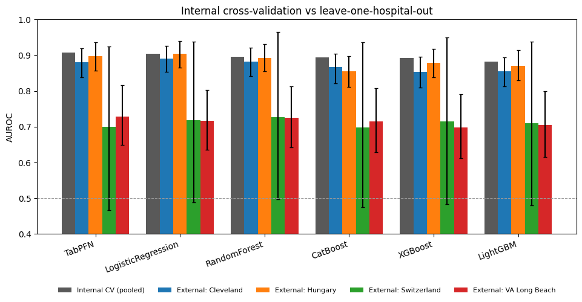
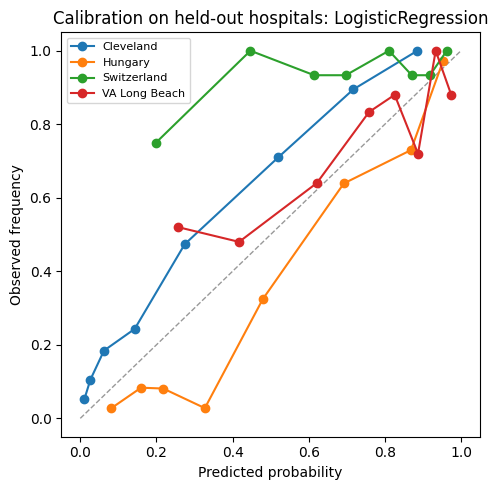
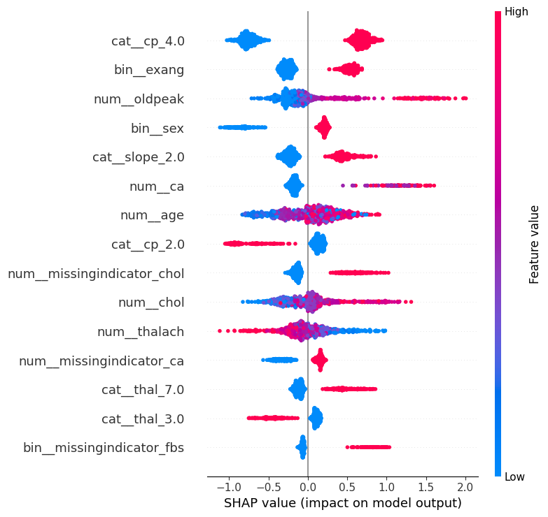

# Heart Disease Prediction V2: Leakage Audit and Cross-Hospital Validation

[](https://github.com/MHKhan50/heart-disease/actions/workflows/tests.yml)

[](LICENSE)
[](https://www.kaggle.com/code/muzammalhussain11/heart-disease-v2-leakage-audit-hospital-split)

**Status:** V2 experiments complete (October 2026). Results below.

A rebuild of my 2022 heart disease project (V1), which compared Random
Forest, XGBoost and a neural network on a merged heart disease dataset and
reported accuracy only. V2 asks a stricter question: how well do these models
hold up when the evaluation is done properly, and when a model trained at some
hospitals is tested at a hospital it has never seen?

## Why V2

V1 had three weaknesses that are common in published work on this data:

1. **Duplicate rows.** Widely shared merged versions of this dataset contain
   many repeated records. When copies land in both the training and test
   split, scores are inflated.
2. **Accuracy only.** Clinical use needs discrimination (AUROC), sensitivity,
   calibration and confidence intervals.
3. **No external validation.** All data was pooled and split at random, so the
   results say nothing about a new hospital.

## Data

UCI Heart Disease databases from four sites: Cleveland Clinic Foundation,
Hungarian Institute of Cardiology (Budapest), V.A. Medical Center (Long Beach)
and University Hospital (Zurich). The 14 standard attributes are used, with
the source hospital kept on every row. See [`data/README.md`](data/README.md).

## Experiments

| # | Experiment | Question |
|---|---|---|
| 1 | Leakage audit | How much do duplicate rows inflate reported scores? |
| 2 | Leave-one-hospital-out | Train on three hospitals, test on the fourth |
| 3 | Model comparison | Logistic regression, Random Forest, XGBoost, LightGBM, CatBoost, TabPFN v2 |
| 4 | Calibration | Can the predicted probabilities be trusted? |
| 5 | Explainability and subgroups | SHAP feature effects; performance by sex and age band |

Missing values (notably `ca` and `thal` at some sites) are imputed inside the
cross-validation folds, with missing-indicator features, rather than dropped.

## Results

918 patients from four hospitals after removing 2 exact duplicates. Six
models, fixed default hyperparameters, preprocessing fitted inside each
training fold. Full tables are in [`results/`](results).

### 1. Duplicate rows make the widely shared file look almost perfect

Random 80/20 splits of the 1,025-row Kaggle file, 20 repeats, Random Forest
([`leakage_audit.csv`](results/leakage_audit.csv)):

| Data | Rows | Test rows already in training | Accuracy | AUROC |
|---|---|---|---|---|
| As shared (with duplicates) | 1,025 | 97.1% | 0.995 ± 0.008 | 0.999 ± 0.002 |
| Duplicates removed | 302 | 0% | 0.833 ± 0.038 | 0.909 ± 0.032 |

Almost every test row has an exact copy in the training set, so near-perfect
scores on this file measure memorisation, not prediction. This also explains
the very high accuracies (including V1's) reported on it.

### 2. Internally, a simple model is as good as the modern ones

Repeated stratified 5-fold CV on the pooled four-hospital data, 5 repeats
([`internal_cv_summary.csv`](results/internal_cv_summary.csv)):

| Model | AUROC | Brier | ECE |
|---|---|---|---|
| TabPFN | 0.907 ± 0.018 | 0.120 | 0.062 |
| Logistic regression | 0.904 ± 0.015 | 0.122 | 0.066 |
| Random Forest | 0.895 ± 0.023 | 0.129 | 0.073 |
| CatBoost | 0.894 ± 0.024 | 0.129 | 0.075 |
| XGBoost | 0.893 ± 0.020 | 0.127 | 0.070 |
| LightGBM | 0.882 ± 0.022 | 0.139 | 0.097 |

The spread between models (0.88 to 0.91) is about the size of the fold-to-fold
variation. TabPFN is marginally best, but logistic regression is essentially
level with it.

### 3. Performance drops at unseen hospitals, and calibration breaks

Leave-one-hospital-out AUROC with 95% bootstrap CI, all 13 attributes
([`loso_auroc_all.csv`](results/loso_auroc_all.csv)):

| Model | Cleveland | Hungary | Switzerland | VA Long Beach |
|---|---|---|---|---|
| Logistic regression | 0.891 [0.853, 0.925] | 0.904 [0.865, 0.940] | 0.718 [0.488, 0.937] | 0.717 [0.635, 0.802] |
| Random Forest | 0.883 [0.842, 0.921] | 0.893 [0.855, 0.931] | 0.727 [0.497, 0.966] | 0.724 [0.642, 0.812] |
| TabPFN | 0.881 [0.838, 0.919] | 0.898 [0.857, 0.936] | 0.700 [0.466, 0.925] | 0.728 [0.650, 0.816] |
| XGBoost | 0.853 [0.809, 0.895] | 0.880 [0.838, 0.918] | 0.714 [0.484, 0.950] | 0.698 [0.612, 0.791] |
| LightGBM | 0.856 [0.813, 0.894] | 0.871 [0.829, 0.914] | 0.710 [0.480, 0.937] | 0.704 [0.615, 0.799] |
| CatBoost | 0.866 [0.821, 0.904] | 0.855 [0.811, 0.897] | 0.698 [0.476, 0.936] | 0.715 [0.629, 0.807] |



- Cleveland and Hungary transfer well (AUROC 0.85 to 0.90, close to internal CV).
- VA Long Beach drops to about 0.70 to 0.73 for every model, and its upper CI
  bounds (0.79 to 0.82) sit below the internal estimates. Specificity there falls
  to about 0.56 on average.
- Switzerland's estimate is not informative: 115 of its 123 patients have
  disease (93.5%), so its AUROC rests on 8 negatives and the CI spans roughly
  0.47 to 0.97.
- **Calibration does not transfer.** Disease prevalence ranges from 36%
  (Hungary) to 93% (Switzerland). Models over-predict risk in Hungary
  (observed/expected 0.65 to 0.79) and under-predict in Switzerland (1.31 to
  1.48) and VA (1.05 to 1.23); calibration intercepts at Switzerland are
  about +2.4 on the logit scale. A model would need local recalibration
  before use at a new site.



### 4. The model partly learns *which hospital* a patient came from

SHAP values for XGBoost on the pooled data:



The top features are clinically expected: asymptomatic chest pain (`cp = 4`),
exercise-induced angina, ST depression (`oldpeak`), male sex, a flat ST slope
and the number of major vessels (`ca`). But the *missing-value indicators*
for cholesterol, `ca` and fasting blood sugar also carry weight. Cholesterol
is missing for every Switzerland patient, where 93.5% have disease, so
"cholesterol not recorded" acts as a proxy for the hospital rather than for
the patient's physiology.

Removing the three attributes that are mostly missing outside Cleveland
(`slope`, `ca`, `thal`; [`loso_auroc_core.csv`](results/loso_auroc_core.csv))
lowers AUROC at Cleveland (logistic regression 0.891 to 0.857) but slightly
raises it at Switzerland and VA for most models (e.g. Random Forest at
Switzerland 0.727 to 0.789, TabPFN at VA 0.728 to 0.746). The confidence
intervals overlap, so this is suggestive rather than conclusive.

### 5. Subgroups

Out-of-fold AUROC of logistic regression, the model with the best mean
AUROC across held-out hospitals ([`subgroups.csv`](results/subgroups.csv)):
women 0.916 [0.866, 0.955] (n = 193), men 0.882 [0.857, 0.907] (n = 725);
age < 50: 0.920, 50 to 59: 0.898, 60 and over: 0.837 [0.774, 0.893]. Discrimination is
lowest in the oldest group, where disease prevalence is highest (73%).

### Takeaways

1. Check for duplicates before trusting any score on this data.
2. On clean data, logistic regression matches gradient boosting and a tabular
   foundation model internally.
3. Internal CV overstates performance at a new hospital, and probabilities
   need recalibration per site.
4. Missingness patterns can let a model identify the site; this should be
   checked whenever data are pooled from several sources.

## Run it

**On Kaggle (recommended):** copy the [published notebook](https://www.kaggle.com/code/muzammalhussain11/heart-disease-v2-leakage-audit-hospital-split)
(or import [`notebooks/heart_disease_v2.ipynb`](notebooks/heart_disease_v2.ipynb)), set Accelerator = None and Internet = On, add the dataset
`johnsmith88/heart-disease-dataset` (used only for the leakage audit), then
*Save & Run All*. CPU is enough.

**Locally:**

```bash
pip install -e ".[models,dev]"
python scripts/run_all.py --out results            # downloads the UCI files
python scripts/run_all.py --out results --quick    # fast smoke run
pytest                                             # offline tests on synthetic data
```

Outputs: `site_summary.csv`, `leakage_audit.csv`, `internal_cv_summary.csv`,
`loso_auroc_all.csv`, `loso_auroc_core.csv`, `loso_all_metrics.csv`,
`subgroups.csv` and figures (internal vs external AUROC, calibration on
held-out hospitals, SHAP).

## Repository structure

```
src/heartv2/   package: data loading, models, evaluation, plots
notebooks/     Kaggle notebook
scripts/       run_all.py (all experiments from the command line)
tests/         offline tests using synthetic data in the UCI file format
results/       tables and figures
data/          data instructions (data itself is not committed)
```

## Disclaimer

Research code only. Not a medical device and not for diagnosis.

## Citation

See [`CITATION.cff`](CITATION.cff). Please also cite the original data source:
Detrano R, Janosi A, Steinbrunn W, Pfisterer M, et al. International application of a new probability algorithm for the diagnosis of coronary artery disease. *American Journal of Cardiology* 64(5):304-310, 1989.

## License

[MIT](LICENSE) © 2026 Muzammal Hussain
